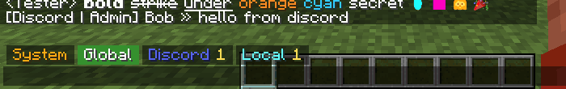
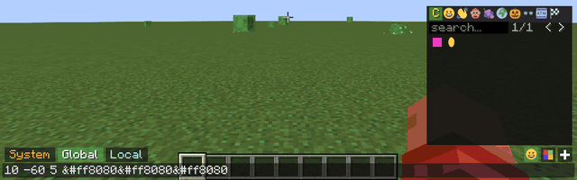
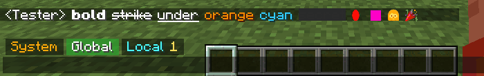
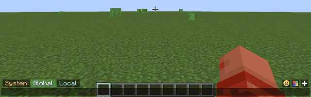

# WF Chat

A chat replacement that stays out of your way: **channel tabs, emoji, text styling and a few handy buttons**, with vanilla chat behaviour underneath.

Install it on the client. Install it on the server too if you want local chat and your own server emoji. Everything else works on any server.

## Channel tabs

- **System**: command feedback and server notices.
- **Global**: normal player chat.
- **Local**: players near you (needs WF Chat on the server).
- **Private**: `/msg` conversations open their own tab.
- Click a tab to view only that channel, Shift-click to merge several. Right-click closes a private tab.
- Unread counters on every tab.

## Emoji

- Type `:smile:`, `:tada:`, `:woman_beard:` or paste a real emoji. Suggestions appear as you type.
- Animated emoji: GIF, animated PNG and animated WebP, plus static WebP.
- **Server emoji**: server owners drop images into a folder and every player with the mod sees them, no resource pack needed. PNG, GIF and WebP are accepted. Files are checked for type, size, dimensions and frame count, and stripped of metadata.
- **Discord emoji** are supported too.
- Picker with category tabs, a Custom tab for server emoji, and search.

## Styling

| You type | You get |
|---|---|
| `**bold**` | **bold** |
| `~~strike~~` | ~~strike~~ |
| `__underline__` | underlined text |
| `&#ff8800orange` | any hex colour, `&#f80` short form works, `&r` resets |
| `\|\|secret\|\|` | spoiler, click to reveal |

Each style can be switched off in `config/wfchat-chat.toml`.

## Buttons next to the chat bar

- **Emoji picker**
- **Colour wheel**: pick a colour and the hex code is inserted for you.
- **Coordinates**: inserts your `x y z`.

## Discord bridge

Using a Discord to Minecraft bridge mod? Its messages get their own **Discord** tab, or stay in Global as well, your choice. Matching is configurable in `config/wfchat-bridges.toml`. Only server messages are matched, so players cannot fake a bridge line.

## Vanity tags

Give players tags such as `[Admin]` or `:crown:` in front of their names with `config/wfchat-vanity.toml`.

## For developers

A plugin API lets other mods add channels, tags and glyphs. See the [GitHub repository](https://github.com/Warfactory-Official/WF-Chat).

## Requirements

- GemRender
- Fabric API on Fabric
- Minecraft 1.20.1 (Forge, Fabric), 1.21.1 (NeoForge, Fabric), 26.1 (NeoForge, Fabric)

## Configuration

All config files are plain TOML in the `config` folder:
`wfchat-chat.toml`, `wfchat-emoji.toml`, `wfchat-vanity.toml`, `wfchat-bridges.toml`, and `wfchat-server.toml` on servers.
